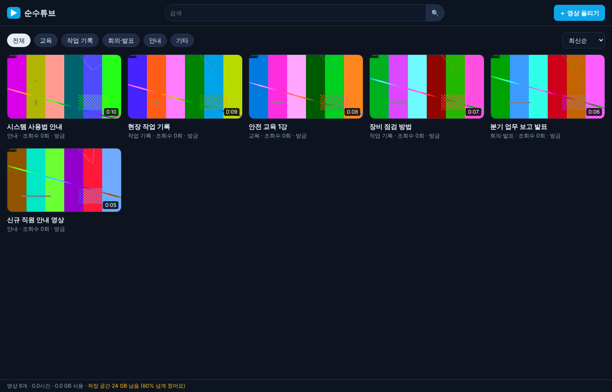

# 순수튜브

사내 영상 플랫폼. 유튜브의 기본 틀(올리기, 재생, 검색, 댓글)을 상수iN 모듈로 만든 것.



## 실행
```
cd module
node server/index.cjs        # http://127.0.0.1:4396
npm test                     # 테스트
```
- 외부 패키지 없음(Node 18 이상). 압축과 썸네일에는 `ffmpeg` 가 필요하다.
- 환경변수: `SUNSUTUBE_PORT`, `SUNSUTUBE_DATA`(영상 저장 폴더), `SUNSUTUBE_MAX_GB`(영상 하나 최대 크기, 기본 4)

계획은 [docs/PLAN.md](docs/PLAN.md).
