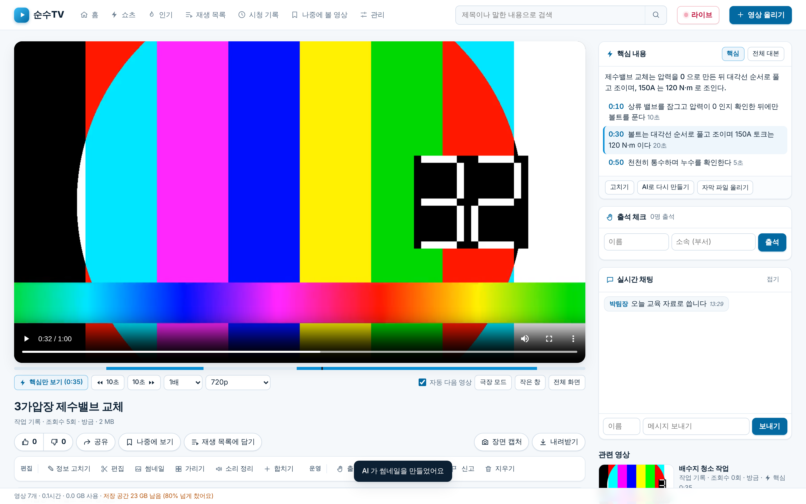
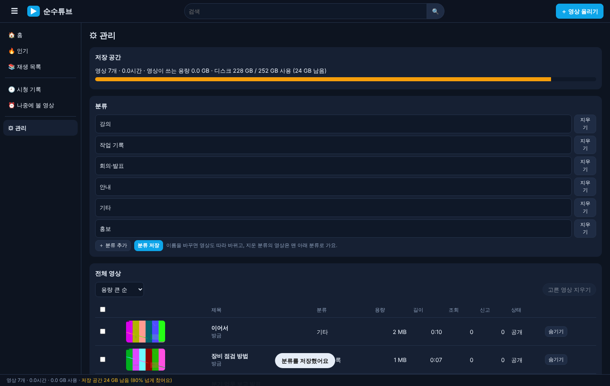

# 순수TV

사내 영상 플랫폼. 유튜브의 기본 틀(올리기, 재생, 검색, 댓글, 재생 목록, 시청 기록, 관리 화면 등)을 상수iN 모듈로 만든 것.





## 핵심 보기
영상의 말소리를 글로 바꾸고 AI 가 핵심 구간을 골라, **핵심만 이어서 보기**와 **핵심 내용 글**을 보여 준다. 추가 비용 없이 서버 안에서만 동작한다.

- 음성 인식 켜기(서버에서 한 번): `bash module/tools/install_stt.sh`
- AI 켜기: 환경변수 `SUNSUTV_LLM_URL=http://<AI 서버>/v1` (모델 이름은 `SUNSUTV_LLM_MODEL`, 기본 `Qwen3.6-35B-A3B-FP8`)
- 꺼져 있어도 자막 파일(.srt/.vtt)을 올리거나 핵심 구간을 직접 고를 수 있다.

## 실행
```
cd module
node server/index.cjs        # http://127.0.0.1:4396
npm test                     # 테스트
```
- 외부 패키지 없음(Node 18 이상). 압축과 썸네일에는 `ffmpeg` 가 필요하다.
- 환경변수: `SUNSUTV_PORT`, `SUNSUTV_DATA`(영상 저장 폴더), `SUNSUTV_MAX_GB`(영상 하나 최대 크기, 기본 4)

계획은 [docs/PLAN.md](docs/PLAN.md).
